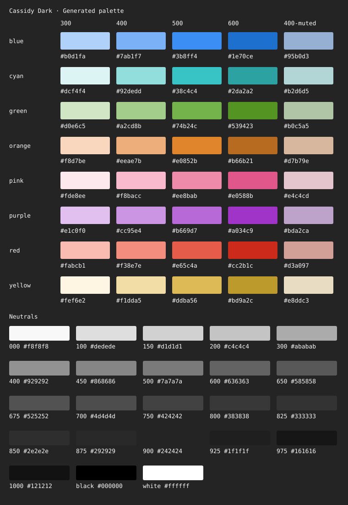

# Generated palette

Generated by `npm run build:palette` or `npm run build:theme`. Edit `src/palette.jsonc` and rebuild.

Target is the requested color; resolved includes gamut limits or overrides; exported is measured from the rounded hex.

| Token                      | Target OKLCH                    | Resolved OKLCH                  | Hex       | Exported OKLCH                  | Override reason                                                            |
| -------------------------- | ------------------------------- | ------------------------------- | --------- | ------------------------------- | -------------------------------------------------------------------------- |
| `palette.blue.300`         | oklch(85.000% 0.075000 255.000) | oklch(85.000% 0.067845 255.000) | `#b0d1fa` | oklch(85.056% 0.067526 254.044) |                                                                            |
| `palette.blue.400`         | oklch(75.000% 0.125000 255.000) | oklch(80.011% 0.099246 254.855) | `#92c1fd` | oklch(80.011% 0.099246 254.855) | Preserve the released color while migrating authoring to generated tokens. |
| `palette.blue.500`         | oklch(65.000% 0.175000 255.000) | oklch(70.081% 0.133777 254.877) | `#62a1f0` | oklch(70.081% 0.133777 254.877) | Preserve the released color while migrating authoring to generated tokens. |
| `palette.blue.600`         | oklch(55.000% 0.225000 255.000) | oklch(55.123% 0.183052 255.238) | `#006fd9` | oklch(55.123% 0.183052 255.238) | Preserve the released color while migrating authoring to generated tokens. |
| `palette.blue.400-muted`   | oklch(75.000% 0.049623 255.000) | oklch(80.043% 0.049561 255.143) | `#a9c0de` | oklch(80.043% 0.049561 255.143) | Preserve the released color while migrating authoring to generated tokens. |
| `palette.cyan.300`         | oklch(95.000% 0.025000 195.000) | oklch(95.000% 0.025000 195.000) | `#dcf4f4` | oklch(94.966% 0.025145 196.736) |                                                                            |
| `palette.cyan.400`         | oklch(85.000% 0.075000 195.000) | oklch(84.941% 0.083359 195.696) | `#89dfdf` | oklch(84.941% 0.083359 195.696) | Preserve the released color while migrating authoring to generated tokens. |
| `palette.cyan.500`         | oklch(75.000% 0.125000 195.000) | oklch(75.110% 0.116728 194.955) | `#35c5c5` | oklch(75.110% 0.116728 194.955) | Preserve the released color while migrating authoring to generated tokens. |
| `palette.cyan.600`         | oklch(65.000% 0.175000 195.000) | oklch(65.000% 0.099822 195.000) | `#2da2a2` | oklch(65.033% 0.099729 194.980) |                                                                            |
| `palette.cyan.400-muted`   | oklch(85.000% 0.041680 195.000) | oklch(85.000% 0.041680 195.000) | `#afd7d6` | oklch(85.031% 0.041999 194.507) |                                                                            |
| `palette.green.300`        | oklch(90.000% 0.050000 135.000) | oklch(90.000% 0.050000 135.000) | `#d0e6c5` | oklch(89.985% 0.050029 135.113) |                                                                            |
| `palette.green.400`        | oklch(80.000% 0.100000 135.000) | oklch(80.109% 0.100648 135.070) | `#a2cd8b` | oklch(80.109% 0.100648 135.070) | Preserve the released color while migrating authoring to generated tokens. |
| `palette.green.500`        | oklch(70.000% 0.150000 135.000) | oklch(70.094% 0.134261 135.061) | `#79b158` | oklch(70.094% 0.134261 135.061) | Preserve the released color while migrating authoring to generated tokens. |
| `palette.green.600`        | oklch(60.000% 0.200000 135.000) | oklch(55.084% 0.161305 135.148) | `#438500` | oklch(55.084% 0.161305 135.148) | Preserve the released color while migrating authoring to generated tokens. |
| `palette.green.400-muted`  | oklch(80.000% 0.050324 135.000) | oklch(80.000% 0.050324 135.000) | `#b0c6a5` | oklch(80.096% 0.051433 135.160) |                                                                            |
| `palette.orange.300`       | oklch(90.000% 0.050000 60.000)  | oklch(90.000% 0.050000 60.000)  | `#f8d7be` | oklch(90.036% 0.049790 59.233)  |                                                                            |
| `palette.orange.400`       | oklch(80.000% 0.100000 60.000)  | oklch(79.960% 0.100349 59.234)  | `#eeae7b` | oklch(79.960% 0.100349 59.234)  | Preserve the released color while migrating authoring to generated tokens. |
| `palette.orange.500`       | oklch(70.000% 0.150000 60.000)  | oklch(69.941% 0.133418 59.631)  | `#da883e` | oklch(69.941% 0.133418 59.631)  | Preserve the released color while migrating authoring to generated tokens. |
| `palette.orange.600`       | oklch(60.000% 0.200000 60.000)  | oklch(55.084% 0.129253 59.942)  | `#a75c00` | oklch(55.084% 0.129253 59.942)  | Preserve the released color while migrating authoring to generated tokens. |
| `palette.orange.400-muted` | oklch(80.000% 0.050174 60.000)  | oklch(80.000% 0.050174 60.000)  | `#d7b79e` | oklch(80.076% 0.050370 59.982)  |                                                                            |
| `palette.pink.300`         | oklch(95.000% 0.025000 0.000)   | oklch(95.000% 0.024171 0.000)   | `#fde8ee` | oklch(94.949% 0.024130 358.282) |                                                                            |
| `palette.pink.400`         | oklch(85.000% 0.075000 0.000)   | oklch(84.884% 0.083504 0.002)   | `#fcb7cb` | oklch(84.884% 0.083504 0.002)   | Preserve the released color while migrating authoring to generated tokens. |
| `palette.pink.500`         | oklch(75.000% 0.125000 0.000)   | oklch(75.000% 0.125000 0.000)   | `#ee8bab` | oklch(75.040% 0.125202 359.810) |                                                                            |
| `palette.pink.600`         | oklch(65.000% 0.175000 0.000)   | oklch(59.985% 0.166695 0.016)   | `#cb4c7c` | oklch(59.985% 0.166695 0.016)   | Preserve the released color while migrating authoring to generated tokens. |
| `palette.pink.400-muted`   | oklch(85.000% 0.041752 0.000)   | oklch(85.000% 0.041752 0.000)   | `#e6c3cc` | oklch(84.970% 0.041366 0.745)   |                                                                            |
| `palette.purple.300`       | oklch(85.000% 0.075000 315.000) | oklch(85.000% 0.075000 315.000) | `#e1c0f0` | oklch(85.122% 0.074373 315.222) |                                                                            |
| `palette.purple.400`       | oklch(75.000% 0.125000 315.000) | oklch(79.903% 0.100165 315.059) | `#d6aaea` | oklch(79.903% 0.100165 315.059) | Preserve the released color while migrating authoring to generated tokens. |
| `palette.purple.500`       | oklch(65.000% 0.175000 315.000) | oklch(70.032% 0.132232 314.722) | `#bd84d7` | oklch(70.032% 0.132232 314.722) | Preserve the released color while migrating authoring to generated tokens. |
| `palette.purple.600`       | oklch(55.000% 0.225000 315.000) | oklch(54.994% 0.182508 314.867) | `#9847b9` | oklch(54.994% 0.182508 314.867) | Preserve the released color while migrating authoring to generated tokens. |
| `palette.purple.400-muted` | oklch(75.000% 0.050082 315.000) | oklch(75.000% 0.050082 315.000) | `#baa5c4` | oklch(75.002% 0.049520 314.923) |                                                                            |
| `palette.red.300`          | oklch(85.000% 0.075000 30.000)  | oklch(85.000% 0.073904 30.000)  | `#fabcb1` | oklch(84.882% 0.073809 30.089)  |                                                                            |
| `palette.red.400`          | oklch(75.000% 0.125000 30.000)  | oklch(75.099% 0.116861 29.800)  | `#ef9182` | oklch(75.099% 0.116861 29.800)  | Preserve the released color while migrating authoring to generated tokens. |
| `palette.red.500`          | oklch(65.000% 0.175000 30.000)  | oklch(64.893% 0.150086 29.672)  | `#db6656` | oklch(64.893% 0.150086 29.672)  | Preserve the released color while migrating authoring to generated tokens. |
| `palette.red.600`          | oklch(55.000% 0.225000 30.000)  | oklch(55.000% 0.198524 30.000)  | `#cc2b1c` | oklch(55.064% 0.198654 29.979)  |                                                                            |
| `palette.red.400-muted`    | oklch(75.000% 0.058431 30.000)  | oklch(75.000% 0.058431 30.000)  | `#d0a198` | oklch(75.000% 0.057687 30.872)  |                                                                            |
| `palette.yellow.300`       | oklch(97.500% 0.037500 90.000)  | oklch(97.500% 0.028470 90.000)  | `#fef6e2` | oklch(97.407% 0.027610 88.748)  |                                                                            |
| `palette.yellow.400`       | oklch(90.000% 0.075000 90.000)  | oklch(90.025% 0.066629 90.260)  | `#efddac` | oklch(90.025% 0.066629 90.260)  | Preserve the released color while migrating authoring to generated tokens. |
| `palette.yellow.500`       | oklch(80.000% 0.125000 90.000)  | oklch(79.997% 0.099836 89.604)  | `#d7bb70` | oklch(79.997% 0.099836 89.604)  | Preserve the released color while migrating authoring to generated tokens. |
| `palette.yellow.600`       | oklch(70.000% 0.175000 90.000)  | oklch(70.000% 0.128745 90.000)  | `#bd9a2c` | oklch(69.955% 0.128617 90.243)  |                                                                            |
| `palette.yellow.400-muted` | oklch(90.000% 0.033315 90.000)  | oklch(90.000% 0.033315 90.000)  | `#e6dec6` | oklch(90.059% 0.033135 91.685)  |                                                                            |
| `palette.gray.100`         | oklch(90.000% 0.000000 0.000)   | oklch(90.000% 0.000000 0.000)   | `#dedede` | oklch(90.060% 0.000000 0.000)   |                                                                            |
| `palette.gray.150`         | oklch(86.000% 0.000000 0.000)   | oklch(86.000% 0.000000 0.000)   | `#d1d1d1` | oklch(86.069% 0.000000 0.000)   |                                                                            |
| `palette.gray.200`         | oklch(82.000% 0.000000 0.000)   | oklch(82.000% 0.000000 0.000)   | `#c4c4c4` | oklch(82.032% 0.000000 0.000)   |                                                                            |
| `palette.gray.300`         | oklch(74.000% 0.000000 0.000)   | oklch(74.000% 0.000000 0.000)   | `#ababab` | oklch(74.123% 0.000000 0.000)   |                                                                            |
| `palette.gray.400`         | oklch(66.000% 0.000000 0.000)   | oklch(66.000% 0.000000 0.000)   | `#929292` | oklch(65.996% 0.000000 0.000)   |                                                                            |
| `palette.gray.450`         | oklch(62.000% 0.000000 0.000)   | oklch(62.000% 0.000000 0.000)   | `#868686` | oklch(62.006% 0.000000 0.000)   |                                                                            |
| `palette.gray.500`         | oklch(58.000% 0.000000 0.000)   | oklch(58.000% 0.000000 0.000)   | `#7a7a7a` | oklch(57.951% 0.000000 0.000)   |                                                                            |
| `palette.gray.600`         | oklch(50.000% 0.000000 0.000)   | oklch(50.000% 0.000000 0.000)   | `#636363` | oklch(49.970% 0.000000 0.000)   |                                                                            |
| `palette.gray.650`         | oklch(46.000% 0.000000 0.000)   | oklch(46.000% 0.000000 0.000)   | `#585858` | oklch(46.040% 0.000000 0.000)   |                                                                            |
| `palette.gray.675`         | oklch(44.000% 0.000000 0.000)   | oklch(44.000% 0.000000 0.000)   | `#525252` | oklch(43.860% 0.000000 0.000)   |                                                                            |
| `palette.gray.700`         | oklch(42.000% 0.000000 0.000)   | oklch(42.000% 0.000000 0.000)   | `#4d4d4d` | oklch(42.024% 0.000000 0.000)   |                                                                            |
| `palette.gray.750`         | oklch(38.000% 0.000000 0.000)   | oklch(38.000% 0.000000 0.000)   | `#424242` | oklch(37.909% 0.000000 0.000)   |                                                                            |
| `palette.gray.800`         | oklch(34.000% 0.000000 0.000)   | oklch(34.000% 0.000000 0.000)   | `#383838` | oklch(34.070% 0.000000 0.000)   |                                                                            |
| `palette.gray.825`         | oklch(32.000% 0.000000 0.000)   | oklch(32.000% 0.000000 0.000)   | `#333333` | oklch(32.109% 0.000000 0.000)   |                                                                            |
| `palette.gray.850`         | oklch(30.000% 0.000000 0.000)   | oklch(30.000% 0.000000 0.000)   | `#2e2e2e` | oklch(30.118% 0.000000 0.000)   |                                                                            |
| `palette.gray.875`         | oklch(28.000% 0.000000 0.000)   | oklch(28.000% 0.000000 0.000)   | `#292929` | oklch(28.094% 0.000000 0.000)   |                                                                            |
| `palette.gray.900`         | oklch(26.000% 0.000000 0.000)   | oklch(26.000% 0.000000 0.000)   | `#242424` | oklch(26.032% 0.000000 0.000)   |                                                                            |
| `palette.gray.925`         | oklch(24.000% 0.000000 0.000)   | oklch(24.000% 0.000000 0.000)   | `#1f1f1f` | oklch(23.929% 0.000000 0.000)   |                                                                            |
| `palette.gray.975`         | oklch(20.000% 0.000000 0.000)   | oklch(20.000% 0.000000 0.000)   | `#161616` | oklch(20.019% 0.000000 0.000)   |                                                                            |
| `palette.gray.1000`        | oklch(18.000% 0.000000 0.000)   | oklch(18.000% 0.000000 0.000)   | `#121212` | oklch(18.220% 0.000000 0.000)   |                                                                            |
| `palette.gray.black`       | oklch(0.000% 0.000000 0.000)    | oklch(0.000% 0.000000 0.000)    | `#000000` | oklch(0.000% 0.000000 0.000)    |                                                                            |
| `palette.gray.white`       | oklch(100.000% 0.000000 0.000)  | oklch(100.000% 0.000000 0.000)  | `#ffffff` | oklch(100.000% 0.000000 0.000)  |                                                                            |
| `palette.gray.000`         | oklch(98.000% 0.000000 0.000)   | oklch(98.000% 0.000000 0.000)   | `#f8f8f8` | oklch(97.913% 0.000000 0.000)   |                                                                            |
